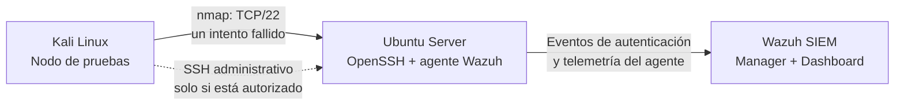

# Laboratorio Purple Team: detección de intentos de acceso SSH

## Resumen ejecutivo

Este proyecto documenta un laboratorio aislado de ciberseguridad para demostrar un ciclo Purple Team: **generar actividad de red y autenticación controlada, observar la telemetría, validar alertas en Wazuh y aplicar medidas de endurecimiento**.

El escenario utiliza Kali Linux como nodo de pruebas, Ubuntu Server como sistema supervisado y Wazuh como plataforma defensiva. El laboratorio se ejecuta en Hyper-V sobre Windows 11 Pro, dentro de una red virtual privada sin conexión directa a redes de producción.

La prueba de autenticación se limita a **un intento fallido deliberado**. No se incluyen ataques de fuerza bruta ni listas de contraseñas. El objetivo es validar la generación y detección de eventos, no obtener acceso a cuentas.

> **Uso autorizado:** ejecutar únicamente en sistemas propios o con autorización explícita. Mantener el conmutador virtual aislado y confirmar las direcciones IP antes de cada prueba.

## Objetivos

- Practicar reconocimiento de servicios con un escaneo acotado de `nmap`.
- Confirmar que Ubuntu y el agente de Wazuh generan y envían telemetría de autenticación.
- Correlacionar la actividad con alertas y registros en Wazuh.
- Aplicar y verificar controles básicos de seguridad para OpenSSH.
- Documentar resultados reproducibles sin almacenar secretos ni datos sensibles.

## Arquitectura



Topología sugerida para Hyper-V:

| Nodo | Función | Ejemplo de IP |
|---|---|---|
| Kali Linux | Pruebas autorizadas | `10.10.50.10/24` |
| Ubuntu Server | Servicio SSH supervisado | `10.10.50.20/24` |
| Wazuh SIEM | Recolección y análisis | `10.10.50.30/24` |

Las direcciones son ejemplos: deben reemplazarse por las asignadas en el laboratorio. No configures una puerta de enlace en la red aislada, salvo que exista una necesidad documentada y controles explícitos.

## Requisitos

- Windows 11 Pro con Hyper-V habilitado.
- Tres máquinas virtuales: Kali Linux, Ubuntu Server y servidor Wazuh.
- Un conmutador virtual **Private** para permitir comunicación entre las VM sin conectarlas a la red física.
- OpenSSH Server y el agente de Wazuh instalados y operativos en Ubuntu.
- Wazuh Manager y Dashboard operativos en el nodo SIEM.
- Una cuenta administrativa autorizada para tareas de configuración.
- Direcciones IP registradas en la tabla de topología.

## Preparación de la red y los nodos

1. **Crear una red aislada en Hyper-V.** En Virtual Switch Manager, crea un conmutador de tipo `Private` y asígnalo a las tres VM. No uses un conmutador externo para el ejercicio.
2. **Asignar direcciones IP.** Configura direcciones únicas dentro de la misma subred. Verifica desde cada VM que puede alcanzar solo los nodos necesarios.
3. **Desplegar Kali Linux.** Actualiza el sistema antes de conectarlo a la red aislada, si necesitas descargar paquetes. Luego limita las pruebas a la IP de Ubuntu documentada en este README.
4. **Desplegar Ubuntu Server.** Instala y habilita OpenSSH Server. Instala y registra el agente Wazuh siguiendo la documentación oficial de Wazuh. Confirma que el agente aparece como activo en el Manager.
5. **Desplegar Wazuh SIEM.** Instala Manager y Dashboard en la VM designada siguiendo la documentación oficial correspondiente a la versión elegida. Sincroniza la hora de las VM para facilitar la correlación de eventos.
6. **Validar conectividad y alcance.** Desde Kali, confirma que Ubuntu y Wazuh responden en la red del laboratorio. Antes de probar, verifica nuevamente la IP objetivo.

## Ejecución controlada

### 1. Reconocimiento limitado

Desde Kali, escanea exclusivamente el puerto SSH de Ubuntu:

```bash
nmap -n -Pn -sT -p 22 --reason 10.10.50.20
```

Reemplaza `10.10.50.20` por la IP real de Ubuntu. Este comando limita el reconocimiento al puerto TCP/22; no amplíes el alcance a otros equipos o redes.

Guarda la salida en la carpeta de evidencias del ejercicio y anota la hora, la IP objetivo y el propósito de la prueba.

### 2. Generar un evento de autenticación fallida

Realiza **un solo intento** con una cuenta de laboratorio no privilegiada. No incluyas contraseñas en comandos, scripts, argumentos ni archivos del repositorio:

```bash
ssh -o PreferredAuthentications=password \
    -o PubkeyAuthentication=no \
    usuario_prueba@10.10.50.20
```

Cuando se solicite la contraseña, introduce deliberadamente una contraseña incorrecta una vez y cancela la sesión. No repitas el intento ni automatices variantes de credenciales.

### 3. Verificar la telemetría en Wazuh

1. En el Dashboard de Wazuh, abre la vista de eventos o alertas correspondiente.
2. Filtra por el agente Ubuntu y por el intervalo horario de la prueba.
3. Busca el evento de autenticación SSH fallida y comprueba que la marca de tiempo coincide con la actividad generada.
4. Registra el identificador de regla, nivel, agente y hora observados. Los identificadores y niveles pueden variar según la versión y configuración de reglas.
5. Si no aparece el evento, valida que el agente esté activo, que la fuente de logs de autenticación esté siendo recogida y que la hora de los nodos esté sincronizada.

## Mitigación y hardening

Aplica los cambios en Ubuntu desde una sesión administrativa que no dependa de la conexión que estás modificando. Mantén acceso por consola de Hyper-V durante el cambio y verifica la configuración antes de reiniciar o recargar SSH.

### 1. Respaldar y revisar la configuración

Antes de editar OpenSSH, crea un respaldo con fecha y conserva sus permisos. Comprueba la sintaxis antes de aplicar cambios:

```bash
sudo cp -a /etc/ssh/sshd_config \
  "/etc/ssh/sshd_config.backup.$(date +%Y%m%d%H%M%S)"
sudo sshd -t
```

### 2. Deshabilitar el acceso SSH de root

En `/etc/ssh/sshd_config`, establece:

```text
PermitRootLogin no
```

Usa una cuenta administrativa individual y aplica el principio de mínimo privilegio.

### 3. Preferir autenticación por llaves

Configura y prueba una llave SSH para una cuenta autorizada antes de deshabilitar la autenticación por contraseña. Una vez confirmada la autenticación por llave y verificado un segundo acceso administrativo, establece:

```text
PubkeyAuthentication yes
PasswordAuthentication no
```

No guardes llaves privadas en este repositorio. Si necesitas documentar una llave, utiliza únicamente una huella digital o una clave pública de prueba no sensible.

### 4. Aplicar los cambios con validación

Valida la sintaxis y recarga el servicio usando el nombre disponible en la distribución:

```bash
sudo sshd -t
sudo systemctl reload ssh || sudo systemctl reload sshd
```

Comprueba que puedes abrir una nueva sesión administrativa antes de cerrar la sesión existente. Si la validación falla, restaura el respaldo y revisa los registros del servicio.

### 5. Limitar el acceso y activar controles

- Limita TCP/22 a las IP o subredes administrativas que realmente lo necesiten mediante el firewall del host o controles equivalentes.
- Comprueba que las reglas de firewall están habilitadas y que no bloquean la administración autorizada.
- Considera Fail2Ban como defensa adicional, con umbrales y tiempos acordes al laboratorio. No lo trates como sustituto de llaves SSH, parches ni reglas de red.
- Mantén OpenSSH y el sistema operativo actualizados.
- Revisa alertas y eventos tras el cambio para confirmar que el agente de Wazuh continúa enviando telemetría.

## Evidencia y resultados

Añade aquí evidencias sanitizadas. No incluyas contraseñas, tokens, llaves privadas, datos personales ni direcciones IP públicas.

| Evidencia | Archivo sugerido | Resultado esperado |
|---|---|---|
| Topología de Hyper-V | `evidence/screenshots/hyperv-network.png` | Se observa el conmutador privado y las VM asignadas |
| Resultado del escaneo acotado | `evidence/logs/nmap-ssh.txt` | Solo se documenta el objetivo autorizado y TCP/22 |
| Estado del agente | `evidence/screenshots/wazuh-agent.png` | El agente Ubuntu figura activo |
| Evento SSH fallido | `evidence/screenshots/wazuh-ssh-alert.png` | Evento relacionado con la prueba y su marca de tiempo |
| Configuración final de SSH | `evidence/screenshots/ssh-hardening.png` | Root login deshabilitado y método de acceso documentado |

### Resumen del ejercicio

- **Fecha y zona horaria:** `[COMPLETAR]`
- **Versión de Wazuh:** `[COMPLETAR]`
- **IP de Kali:** `[COMPLETAR]`
- **IP de Ubuntu:** `[COMPLETAR]`
- **IP de Wazuh:** `[COMPLETAR]`
- **Evento o regla observada:** `[COMPLETAR]`
- **Resultado del hardening:** `[COMPLETAR]`
- **Observaciones y acciones pendientes:** `[COMPLETAR]`

## Scripts

- `scripts/audit_and_collect.sh`: previsto para ejecutar verificaciones acotadas y recopilar resultados del laboratorio. Revisar y configurar sus parámetros antes de usarlo.
- `scripts/harden_ssh.sh`: previsto para aplicar controles básicos en Ubuntu con respaldo previo y validación. Ejecutarlo únicamente con autorización y acceso de recuperación a la VM.

Los scripts deben leer la configuración desde parámetros o variables de entorno, validar la IP objetivo y no aceptar ni almacenar contraseñas. No ejecutes archivos de scripts descargados o modificados sin revisar su contenido.

## Criterios de éxito

- El escaneo está limitado a la IP de Ubuntu y al puerto documentado.
- El evento de autenticación generado aparece asociado al agente Ubuntu en Wazuh.
- La configuración SSH se valida antes de recargar el servicio.
- Root no puede iniciar sesión por SSH y la autenticación por llave se prueba antes de deshabilitar contraseñas.
- Las evidencias no contienen secretos ni información ajena al laboratorio.

## Referencias

- [Documentación oficial de Wazuh](https://documentation.wazuh.com/)
- [Manual de OpenSSH `sshd_config`](https://man.openbsd.org/sshd_config)
- [Documentación de Hyper-V en Microsoft Learn](https://learn.microsoft.com/windows-server/virtualization/hyper-v/)

## Descargo de responsabilidad

Este repositorio es material educativo y de demostración. Las pruebas deben ejecutarse únicamente en infraestructura propia o expresamente autorizada, dentro del alcance documentado y con medidas de recuperación disponibles.
